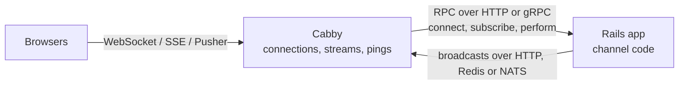

<p align="center">
  
</p>

# Cabby

Cabby is a real-time server for Rails apps (and other backends) that holds your WebSocket
connections so your app doesn't have to. It is an [AnyCable](https://github.com/anycable/anycable)-compatible
server written in Rust: the same client protocols, the same RPC contract with your app, and the
same flags, `ANYCABLE_*` variables and `anycable.toml` as the Go server it is ported from.

**[Documentation](https://docs.cabbyhq.com/install)** · [Releases](https://github.com/DaniG2k/cabby-releases/releases) · [Benchmarks](#benchmarks) · [Changelog](CHANGELOG.md)

## Why Cabby

With Action Cable, every WebSocket lives inside your Puma processes and competes with the app
itself. Cabby moves the connections into a separate server and calls your channels only when
something happens, so idle connections cost your Rails app nothing.

- **Much less memory.** 10,000 idle clients take 109 MB, against 390 MB for Action Cable and
  288 MB for the Go server.
- **Load Action Cable can't carry.** Every message delivered at 150k/s on 2 cores; Action Cable
  topped out at 21–27k/s.
- **Lower tail latency than the Go server** (p99 22–36% lower at every load) at about the same CPU.
- **Nothing to rewrite.** Your channels, broadcasts, the `anycable-rails` gem and the JavaScript
  client stay as they are.

Not on Rails? Cabby also speaks the Pusher protocol (pusher-js, Laravel Echo), and its RPC and
broadcast interfaces are plain HTTP. With JWT and signed streams it needs no RPC backend at all.

## How it fits



Cabby holds the connections and subscriptions, keeps stream history and sends pings. When a
client connects, subscribes or performs an action, Cabby calls your app over RPC and your channel
code decides. When your app broadcasts, it sends the message to Cabby, which delivers it to every
subscriber. Several Cabby nodes can share broadcasts through Redis, NATS or PostgreSQL.

## Features

- **Protocols:** Action Cable (and its extended version with stream history), Pusher, Server-Sent
  Events, Durable Streams
- **Your app:** RPC over HTTP or gRPC; broadcasts over HTTP, Redis, NATS or PostgreSQL
- **Reliable streams:** history and session recovery after a reconnect, kept in memory, SQLite
  (one node), Redis, PostgreSQL or NATS
- **Several nodes:** pub/sub through [Redis](docs/redis-broker.md), [PostgreSQL](docs/postgres.md)
  or NATS
- **Identity:** JWT, signed streams, Turbo Streams; presence
- **Operations:** Prometheus metrics and log lines named as in the Go server

## Install

```sh
docker run --rm -p 8080:8080 -p 8090:8090 ghcr.io/danig2k/cabby:0.3.0 --norpc --public
```

The image (linux/amd64 and arm64) runs without Redis and takes broadcasts over HTTP only; to use
Redis, add `redis` or `redisx` to `CABBY_BROADCAST_ADAPTER`. There are also
[prebuilt binaries](https://github.com/DaniG2k/cabby-releases/releases) for Linux and macOS, a
[Kamal guide](docs/deploy-kamal.md), and instructions to
[build from source](docs/development.md#build-from-source). The full install guide is at
[docs.cabbyhq.com](https://docs.cabbyhq.com/install).

## Quick start

On its own (`--public` skips authentication, so use it only locally):

```sh
cabby --norpc --public --broadcast_adapter=http

curl -X POST localhost:8090/_broadcast -H 'Content-Type: application/json' \
  -d '{"stream":"demo","data":"{\"text\":\"hello\"}"}'
```

Clients connect to `ws://localhost:8080/cable`.

Next to a Rails app: add the `anycable-rails` gem, run `bin/rails g anycable:setup`, mount HTTP
RPC at `/_anycable`, turn on HTTP broadcasting with the same secret, and start Cabby:

```sh
cabby --rpc_host=http://localhost:3000/_anycable --secret=…
```

Cabby prints the URLs to point the gem's `http_broadcast_url` and your JavaScript client at. For
gRPC, run `bundle exec anycable` and leave out `--rpc_host` (default `localhost:50051`). Every flag
has a `CABBY_*` variable (`ANYCABLE_*` works too); see
[`docs/configuration.md`](docs/configuration.md). Guides for Rails, Hotwire, Laravel, Node.js and
Django are at [docs.cabbyhq.com](https://docs.cabbyhq.com/rails).

## Benchmarks

One machine, the same workloads for every server, medians of 5 runs, every message checked:

| | Action Cable | Go server | Cabby |
|---|---:|---:|---:|
| Memory, 10,000 idle clients | 390 MB | 288 MB | **109 MB** |
| 100k msg/s: delivered | 26% | 100% | 100% |
| 100k msg/s: p99 latency | 45.5 s | 2.77 ms | **1.78 ms** |
| 150k msg/s: p99 latency | 47.7 s | 11.93 ms | **7.69 ms** |
| 150k msg/s: server CPU | 1.00 core (saturated) | 2.95 cores | **2.79 cores** |
| Peak OS threads, reconnect flood | 22 | **10** | 412 |

[`docs/benchmarks.md`](docs/benchmarks.md) has every workload, the Pusher-protocol comparison with
Soketi and Reverb, a two-hour soak test, the method, and the scripts to rerun them.

## Compatibility

Built tests-first: the whole upstream test corpus, 923 cases, was translated to Rust and verified
against the Go server. 922 pass against Cabby; 1 is retired by design (telemetry). Intended
differences are listed in [`compat/deviations.md`](compat/deviations.md). AnyCable Pro features are
out of scope.

**Migrating from AnyCable:** swap the `anycable-go` binary for `cabby` and keep your configuration.
[`docs/compatibility.md`](docs/compatibility.md) covers the few differences and the features kept
for compatibility.

## Development

[`docs/development.md`](docs/development.md) covers building, the repository layout and running the
tests; [`docs/implementing.md`](docs/implementing.md) and
[`docs/translating-tests.md`](docs/translating-tests.md) go deeper.

## License and attribution

Cabby is released under the [MIT License](LICENSE).

Cabby's implementation is a port of the AnyCable Go server (MIT, © Vladimir Dementyev), pinned at
the commit in [`compat/upstream.lock`](compat/upstream.lock), and its translated tests and scenarios
derive from AnyCable, AnyT (MIT, © palkan) and go-mruby (MIT, © Mitchell Hashimoto). Their notices
are in [`compat/licenses/`](compat/licenses/). Cabby is an independent implementation, not
affiliated with the AnyCable project or Evil Martians.

Cabby also includes third-party software; see [`docs/third-party.md`](docs/third-party.md).
