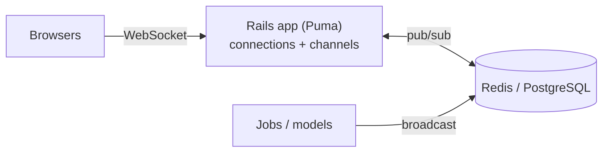
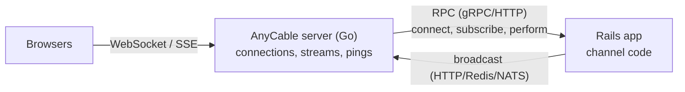
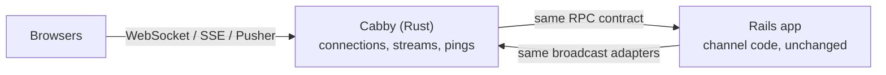
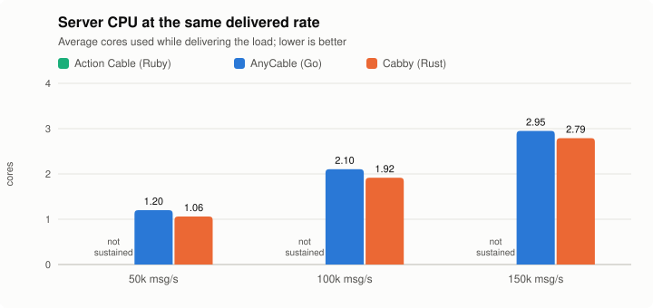

<p align="center">
  
</p>

# Cabby

An [AnyCable](https://github.com/anycable/anycable)-compatible real-time server written in
Rust. It is a drop-in replacement for the AnyCable server: the same Action Cable protocol, the
same RPC contract with your Rails app, the same CLI flags, environment variables and
configuration file. Cabby is an independent implementation; it is not affiliated with the
AnyCable project or Evil Martians.

> **Status: feature-complete.** `cabby` passes all 923 translated upstream test cases, including
> the full AnyT conformance suite end to end, with SSE, Pusher, durable streams, Redis, NATS and
> mruby (see [`SPEC.md`](SPEC.md)).

## Action Cable, AnyCable and Cabby

All three serve the same client: a browser using the `@rails/actioncable` (or AnyCable) JavaScript
client, talking to channels you write in Rails. They differ in **where the WebSocket connections
live** and what runs them.

### Action Cable: everything in the Rails process



Rails' built-in framework. Every WebSocket is held by a Ruby process alongside your web
requests, so connection count, memory and broadcast fan-out compete with the app itself.

### AnyCable: a dedicated WebSocket server, channels stay in Rails



The connections move to a standalone server. Your Rails channels are unchanged and are called
over RPC only when something happens (connect, subscribe, perform); idle connections cost the
Rails app nothing. AnyCable adds reliable streams (history and recovery), presence, JWT
identification, signed streams, SSE, Pusher compatibility and durable streams.

### Cabby: the same architecture, a Rust server



Cabby replaces the AnyCable server binary and nothing else: the Rails side (`anycable-rails`,
your channels, your broadcasts) and the JavaScript client stay as they are.

### Feature comparison

| | Action Cable | AnyCable (Go) | Cabby (Rust) |
|---|:---:|:---:|:---:|
| Where WebSockets are handled | Rails process | Go server | Rust server |
| Channel code | Ruby | Ruby (over RPC) | Ruby (over RPC, unchanged) |
| Action Cable protocol (`actioncable-v1-json`, extended protocol) | ✅ | ✅ | ✅ |
| RPC over gRPC and HTTP | n/a | ✅ | ✅ |
| Broadcasts via HTTP, Redis (pub/sub, streams), NATS | Redis/PostgreSQL | ✅ | ✅ |
| Multi-node pub/sub (Redis, NATS) | via adapter | ✅ | ✅ |
| Reliable streams: history and session recovery | – | ✅ | ✅ |
| Presence | – | ✅ | ✅ |
| JWT identification, signed and Turbo streams | – | ✅ | ✅ |
| Server-Sent Events | – | ✅ | ✅ |
| Pusher protocol compatibility | – | ✅ | ✅ |
| Durable Streams (HTTP catch-up, long-poll, SSE) | – | ✅ | ✅ |
| Embedded NATS | – | ✅ (in-process) | ✅ (bundled `nats-server` child process) |
| mruby metrics printers | – | ✅ | ✅ |
| Recovers when Redis silently drops a subscription ([AnyCable issue 275](https://github.com/anycable/anycable/issues/275)) | – | ❌ stays broken until restart | ✅ resubscribes (~1 s) / heartbeat (~10 s) |
| Concurrency model | Ruby threads | goroutines | Tokio tasks; no OS thread per connection |

AnyCable features above are those of the pinned open-source server
(`anycable/anycable@26a1a703`); AnyCable Pro features are out of scope. Intended differences from
the Go server are recorded in [`compat/deviations.md`](compat/deviations.md), most with a pinning test.

## Benchmarks: Go vs Rust

Release builds of both servers, launched with identical AnyCable flags by Cabby's external load
harness ([`crates/cabby-bench`](crates/cabby-bench)), measured on one machine (AMD Ryzen 5 PRO
6650H, Linux 7.3). The server under test was pinned to 2 physical cores (4 CPUs); the load
generator ran on the other 4 cores. Each value is the median of 3 runs. Every delivered message
was reconciled by ID, and no run lost, duplicated or reordered a message.

<p align="center">
  
  
  
</p>

| Workload | Metric | AnyCable (Go) | Cabby (Rust) |
|---|---|---:|---:|
| Idle connections | Memory with 1,000 / 10,000 clients | 55 / 290 MB | 22 / 100 MB |
| | Memory per extra connection | 26.8 KB | **8.8 KB** |
| Fan-out, 1,000 clients × 5 of 100 streams | Delivered at 50k / 100k / 150k msg/s | 100% / 100% / 100% | 100% / 100% / 100% |
| | Latency p50 at 50k / 100k / 150k msg/s | 0.39 / 0.34 / 0.81 ms | 0.32 / 0.27 / 0.61 ms |
| | Latency p99 at 50k / 100k / 150k msg/s | 0.81 / 2.50 / 9.35 ms | 0.67 / 1.46 / 7.32 ms |
| | Server CPU at 50k / 100k / 150k msg/s | 1.22 / 2.08 / 3.00 cores | 1.11 / 1.87 / 2.81 cores |
| | Server memory | 72 MB | 28 MB |
| Large room, 5,000 clients on one stream, 100k msg/s | Latency p50 / p99 | 26.0 / 59.7 ms | 22.5 / 46.8 ms |
| | Server CPU / memory | 3.20 cores / 176 MB | 3.17 cores / 58 MB |
| Reconnect floods: 2,000 clients, 500 then 1,000 dropped at once, 5 ms RPC | Recovery after each wave | 0.81 s / 1.02 s | 0.81 s / 1.02 s |
| | Connect → welcome p99 | 97 ms | 93 ms |
| | Ping round trip p99 during the floods | 0.5 ms | 0.5 ms |
| | Server memory | 101 MB | 38 MB |
| OS threads | Idle / peak during a 10,000-client connect burst | 10 / 11 | 33 / 101 |

What this shows:

- **Memory is where Cabby wins clearly**: about a third of Go's per connection and overall.
- **Latency and CPU are modestly better** (17–42% lower p99 latency, 1–10% less CPU at the
  same delivered rate). Neither server hit its throughput ceiling at 150k deliveries/s on
  2 cores, so peak throughput is not compared here.
- **Reconnect recovery is identical**: it is governed by the clients' backoff and the
  disconnect-queue rate, which both servers implement the same way.
- **Go uses fewer OS threads.** Go multiplexes its goroutines onto about one thread per CPU.
  Cabby has a fixed set of helper threads (hub shards, timers, adapters) plus a bounded
  command pool that grows during connect bursts and shrinks after 30 s idle. Thread count
  never scales with connections in either server.
- **Not measured yet:** slow readers mixed with healthy clients, a slow or unavailable RPC with
  queue saturation, and multi-node (Redis/NATS) broadcast.

Reproduce: `cargo build --release -p cabby-server -p cabby-bench && cargo xtask reference-build
&& compat/scripts/bench-compare.sh`, then `compat/scripts/bench-summary.py` and
`compat/scripts/bench-charts.py`. Raw results for these numbers are in
[`docs/benchmarks/results`](docs/benchmarks/results); methodology:
[`SPEC.md` §10](SPEC.md#10-performance-evaluation).

## Compatibility progress

Cabby is built tests-first: AnyCable's entire test corpus was translated to Rust and verified
against the Go server before any Cabby code was written; a feature counts as done when its
translated tests pass against Cabby.

| | Count |
|---|---:|
| Upstream cases (Go unit tests, Benchi, go-mruby, features, AnyT conformance) | 923 |
| Translated to Rust and independently reviewed | 923 |
| Verified against the Go server | 914 |
| Go cannot expose the behavior (`not_observable`, tested against Rust only) | 9 |
| **Passing against Cabby** | **923** |

Source of truth: [`compat/test-map.json`](compat/test-map.json), summarized by `cargo xtask report`.

## Layout

```text
crates/cabby-core      protocol, JSON, hub, brokers, pub/sub, identity, configuration
crates/cabby-server    node, RPC, WebSocket/SSE/Pusher/durable streams, adapters, CLI, `cabby` binary
crates/cabby-bench     external load harness (Go vs Rust comparisons)
crates/cabby-testkit   backend selection, Go reference bridge, fake RPC, process supervision
tests/                 translated upstream tests (unit/<go package>, conformance, features)
tools/xtask            inventory, compatibility runner, reports
compat/                pinned reference, baseline evidence, manifest, deviations, adapters
docs/                  contributor guides
```

## Development

Toolchains are pinned in `mise.toml` (Rust 1.100.0, plus Go 1.27.3 and protoc for the reference
server during the port).

```sh
mise install
cargo xtask reference-checkout          # pinned upstream into compat/reference
cargo xtask reference-build             # Go reference binary + test bridge
eval "$(compat/scripts/services.sh start)"   # Redis + NATS for integration tests
cargo xtask test --backend go           # translated tests against Go: must pass
cargo xtask test --backend rust         # against Cabby: pass or explicitly pending
cargo xtask report --by-package
```

To try it by hand (start, connect, broadcast, SSE, metrics), follow
[`docs/manual-testing.md`](docs/manual-testing.md). See [`docs/implementing.md`](docs/implementing.md) and
[`docs/translating-tests.md`](docs/translating-tests.md).

## License and attribution

Cabby is released under the [MIT License](LICENSE), the same license as AnyCable.

Translated tests and scenarios derive from AnyCable (MIT, © Vladimir Dementyev), AnyT
(MIT, © palkan) and go-mruby (MIT, © Mitchell Hashimoto). Their notices are in
[`compat/licenses/`](compat/licenses/).

Cabby statically links a C dependency: mruby 1.2.0 (MIT, © mruby developers) with the
mruby-env gem (MIT, © Internet Initiative Japan Inc.), vendored in
[`crates/cabby-mruby-sys`](crates/cabby-mruby-sys) for the optional mruby scripting
feature (cargo feature `mruby`, on by default on Linux and macOS). Their notices are
`compat/licenses/mruby-MITL` and `compat/licenses/mruby-env-LICENSE`; the binding's API
is modeled on go-mruby (see [`docs/mruby.md`](docs/mruby.md)).
