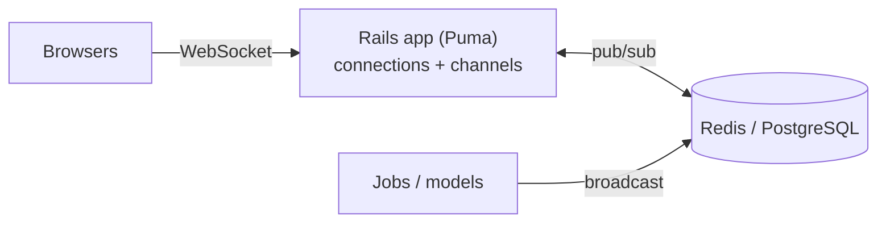
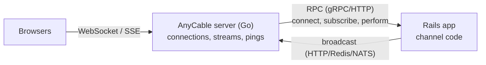
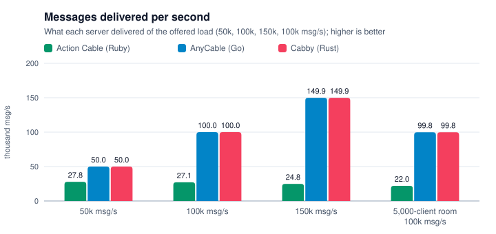
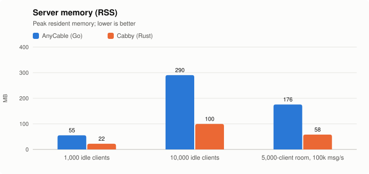
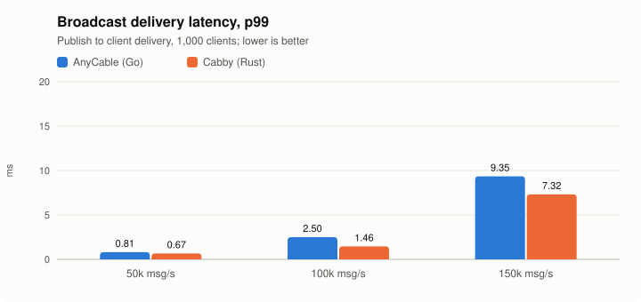
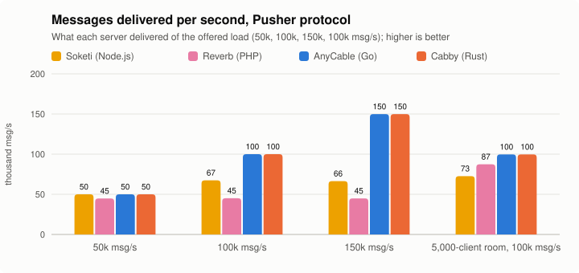
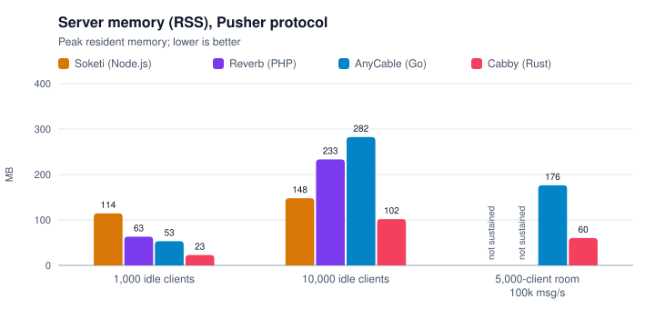
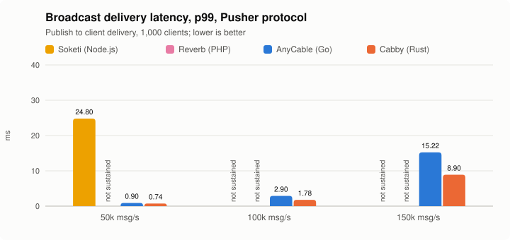

<p align="center">
  
</p>

# Cabby

An [AnyCable](https://github.com/anycable/anycable)-compatible real-time server written in
Rust. It is a drop-in replacement for the AnyCable server: the same Action Cable protocol, the
same RPC contract with your Rails app, the same CLI flags, environment variables and
configuration file. Cabby is an independent implementation; it is not affiliated with the
AnyCable project or Evil Martians.

> **Status: feature-complete, reviewed, not yet production-proven.** `cabby` passes all 923
> translated upstream test cases, including the full AnyT conformance suite end to end, with SSE,
> Pusher, durable streams, Redis, NATS and mruby. An [independent review](docs/review/2026-11-fable-review.md)
> and a [security review](docs/review/2026-11-security-review.md) found the wire protocol faithful
> to AnyCable; every failure, overload and security finding they raised is fixed, with regression
> tests. It has not run in production yet: try it in staging first.

## Action Cable, AnyCable and Cabby

All three serve the same client: a browser using the `@rails/actioncable` (or AnyCable) JavaScript
client, talking to channels you write in Rails. They differ in **where the WebSocket connections
live** and what runs them.

### Action Cable: everything in the Rails process



Rails' built-in framework. Every WebSocket is held by a Ruby process alongside your web
requests, so connection count, memory and broadcast fan-out compete with the app itself.

### AnyCable: a dedicated WebSocket server, channels stay in Rails



The connections move to a standalone server. Your Rails channels are unchanged and are called
over RPC only when something happens (connect, subscribe, perform); idle connections cost the
Rails app nothing. AnyCable adds reliable streams (history and recovery), presence, JWT
identification, signed streams, SSE, Pusher compatibility and durable streams.

### Cabby: the same architecture, a Rust server


Cabby replaces the AnyCable server binary and nothing else: the Rails side (`anycable-rails`,
your channels, your broadcasts) and the JavaScript client stay as they are.

### Feature comparison

| | Action Cable | AnyCable (Go) | Cabby (Rust) |
|---|:---:|:---:|:---:|
| Where WebSockets are handled | Rails process | Go server | Rust server |
| Channel code | Ruby | Ruby (over RPC) | Ruby (over RPC, unchanged) |
| Action Cable protocol (`actioncable-v1-json`, extended protocol) | ✅ | ✅ | ✅ |
| RPC over gRPC and HTTP | n/a | ✅ | ✅ |
| Broadcasts via HTTP, Redis (pub/sub, streams), NATS | Redis/PostgreSQL | ✅ | ✅ |
| Multi-node pub/sub (Redis, NATS) | via adapter | ✅ | ✅ |
| Reliable streams: history and session recovery | – | ✅ | ✅ |
| Presence | – | ✅ | ✅ |
| JWT identification, signed and Turbo streams | – | ✅ | ✅ |
| Server-Sent Events | – | ✅ | ✅ |
| Pusher protocol compatibility | – | ✅ | ✅ |
| Durable Streams (HTTP catch-up, long-poll, SSE) | – | ✅ | ✅ |
| Embedded NATS | – | ✅ (in-process) | ✅ (bundled `nats-server` child process) |
| mruby metrics printers | – | ✅ | ✅ |
| Recovers when Redis silently drops a subscription ([#275](https://github.com/anycable/anycable/issues/275)) | – | ❌ stays broken until restart | ✅ resubscribes (~1 s) / heartbeat (~10 s) |
| Malformed Pusher frames | – | ❌ crashes the process | ✅ ignored |
| Concurrency model | Ruby threads | goroutines | Tokio tasks; no OS thread per connection |

AnyCable features above are those of the pinned open-source server
(`anycable/anycable@26a1a703`); AnyCable Pro features are out of scope. Intended differences from
the Go server are recorded, with pinning tests, in [`compat/deviations.md`](compat/deviations.md);
differences found by the review and not yet fixed are listed in
[`docs/review/2026-11-fable-review.md`](docs/review/2026-11-fable-review.md).

## Benchmarks: Action Cable vs AnyCable vs Cabby

All three servers driven by the same external load harness ([`crates/cabby-bench`](crates/cabby-bench))
on one machine (AMD Ryzen 5 PRO 6650H, Linux 7.3). The server under test was pinned to 2 physical
cores (4 CPUs) and the load generator to the other 4 cores. Each workload got a warm-up run, then
5 rounds with the servers in a shuffled order; values are medians. Every delivered message was
reconciled by ID.

- **AnyCable and Cabby**: release builds launched with identical flags (`--norpc --noauth
  --public_streams`, in-memory broker, HTTP broadcasts, about 20-byte payloads over loopback; the
  churn workload adds a 5 ms HTTP RPC).
- **Action Cable**: Rails 8.1 (`actioncable` + `railties`) on Puma 8.1 in one process, production
  mode, async adapter, Ruby 4.0 with YJIT, default worker pool; a `$pubsub` channel and a broadcast
  endpoint calling `ActionCable.server.broadcast` ([`bench/actioncable`](bench/actioncable)). In the
  churn workload it sleeps the same 5 ms in `connect`, `subscribed` and `disconnect` where AnyCable
  makes RPC calls.

<p align="center">
  
  
  
  
</p>

| Workload | Metric | Action Cable (Ruby) | AnyCable (Go) | Cabby (Rust) |
|---|---|---:|---:|---:|
| Idle connections | Memory with 1,000 / 10,000 clients | 120 / 390 MB | 54 / 288 MB | **24 / 109 MB** |
| | Memory per extra connection | 30.7 KB | 26.6 KB | **9.7 KB** |
| Fan-out, 1,000 clients × 5 of 100 streams, 50k msg/s | Delivered | 53% of the rate, 17.6 s p99 behind | 100% | 100% |
| | Latency p50 / p99 | 12.8 s / 17.6 s | 0.39 / 0.86 ms | 0.31 / 0.67 ms |
| | Server CPU / memory | 1.00 core (saturated) / 454 MB | 1.20 cores / 72 MB | 1.06 cores / 30 MB |
| Same, 100k msg/s | Delivered | 26% of the rate; 2.0 M messages lost | 100% | 100% |
| | Latency p50 / p99 | 30.8 s / 45.5 s | 0.34 / 2.77 ms | 0.28 / 1.78 ms |
| | Server CPU / memory | 1.00 core / 1,030 MB | 2.10 cores / 72 MB | 1.92 cores / 30 MB |
| Same, 150k msg/s | Delivered | 16% of the rate; 7.4 M messages lost | 100% | 100% |
| | Latency p50 / p99 | 33.9 s / 47.7 s | 0.86 / 11.93 ms | 0.70 / 7.69 ms |
| | Server CPU / memory | 1.00 core / 1,550 MB | 2.95 cores / 72 MB | 2.79 cores / 30 MB |
| Large room: 5,000 clients on one stream, 100k msg/s | Delivered | 21% of the rate; 3.8 M lost | 100% | 100% |
| | Latency p50 / p99 | 30.8 s / 47.7 s | 27.3 / 65.8 ms | 24.8 / 51.6 ms |
| | Server CPU / memory | 1.00 core / 1,129 MB | 3.27 cores / 179 MB | 3.24 cores / 63 MB |
| Reconnect floods: 2,000 clients, 500 then 1,000 dropped at once, 5 ms app latency | Recovery after each wave | 2.8 s / 5.6 s | 0.81 s / 1.02 s | 0.81 s / 1.02 s |
| | Connect → welcome p99 | 2,143 ms | 97 ms | 93 ms |
| | Server memory | 177 MB | 101 MB | 58 MB |
| | Peak OS threads | 22 | 10 | 412 |
| Any workload | Missing / duplicate / out-of-order messages | up to millions / 0 / hundreds | 0 / 0 / 0 | 0 / 0 / 0 |

What this shows:

- **Action Cable can't keep up with any of these loads.** Ruby runs on one core (it was pegged at
  1.00), and Action Cable decodes and re-encodes each message for every subscriber. It topped out
  at 21–27k deliveries/s whatever was offered, fell tens of seconds behind, buffered up to 1.5 GB,
  lost millions of messages once its publisher queue filled, and delivered some out of order.
  That's the reason AnyCable exists, and it applies to Cabby equally.
- **Cabby uses a third of AnyCable's memory** (9.7 KB vs 26.6 KB per connection; 30 MB vs 72 MB
  under fan-out) and about a quarter of Action Cable's.
- **Cabby's tail latency is lower** (p99 22–36% below AnyCable's at every load), with 1–12% less
  CPU at the same delivered rate; the CPU difference is close to run-to-run spread, so call it
  slightly better or equal.
- **Reconnect recovery is identical to AnyCable's**: it is governed by the clients' backoff and the
  disconnect-queue rate, which both servers implement the same way.
- **AnyCable uses far fewer OS threads.** Go runs its goroutines on about one thread per core. Cabby
  has a fixed set of helper threads, and a session waiting on an RPC call holds a parked thread (so
  that one slow RPC never delays other sessions): 412 during the reconnect flood. They are capped
  at 8,192 and exit 30 s after the backlog clears. Thread count never grows with idle connections.
- **Neither AnyCable nor Cabby hit their throughput ceiling** at 150k deliveries/s on 2 cores, so
  peak throughput isn't compared. Not measured yet: slow readers, an unavailable RPC and
  multi-node (Redis/NATS) broadcast. Pusher-protocol servers are compared in the next section.

Reproduce: `cargo build --release -p cabby-server -p cabby-bench && cargo xtask reference-build &&
compat/scripts/bench-compare.sh` (Action Cable needs its gems: see
[`bench/actioncable`](bench/actioncable)), then `compat/scripts/bench-summary.py` and
`compat/scripts/bench-charts.py`. Raw results: [`docs/benchmarks/results`](docs/benchmarks/results)
(AnyCable and Cabby re-measured together on the final build; Action Cable from the same day's
three-way run). Methodology: [`SPEC.md` §10](SPEC.md#10-performance-evaluation).

## Benchmarks: Pusher-protocol servers

Cabby and AnyCable also speak the Pusher protocol, so pusher-js and Laravel Echo clients can use
them in place of Pusher. They are compared here with the two common self-hosted Pusher servers:
**Soketi** 1.6.1 (Node.js 18 on uWebSockets) and **Laravel Reverb** 1.14 (PHP 8.4, ReactPHP with
the `ev` event loop). Hosted Pusher is not included (a paid service on unknown hardware, and
load-testing it would breach its terms).

The method is the same as above (same machine and pinning, warm-up, 5 shuffled rounds, medians,
every message reconciled by ID), with the harness speaking the pusher-js protocol 7 to
`/app/<key>` and broadcasting through the signed Pusher REST API, one event per request.
Production settings for every server; details in [`bench/pusher`](bench/pusher).

<p align="center">
  
  
  
</p>

| Workload | Metric | Soketi (Node.js) | Reverb (PHP) | AnyCable (Go) | Cabby (Rust) |
|---|---|---:|---:|---:|---:|
| Idle connections | Memory with 1,000 / 10,000 clients | 116 / 149 MB | 63 / 233 MB | 54 / 280 MB | **24 / 103 MB** |
| | Memory per extra connection | **3.7 KB** | 19.3 KB | 25.8 KB | 9.0 KB |
| Fan-out, 1,000 clients, 50k msg/s | Delivered / p99 latency | 100% / 24.8 ms | 90% of the rate / 84 ms | 100% / 0.90 ms | 100% / **0.74 ms** |
| Same, 100k msg/s | Delivered / p99 latency | 67% of the rate / 60 ms | 45% / 84 ms | 100% / 2.90 ms | 100% / **1.78 ms** |
| Same, 150k msg/s | Delivered / p99 latency | 44% / 60 ms | 30% / 88 ms | 100% / 15.2 ms | 100% / **8.9 ms** |
| | Server CPU / memory | 1.01 cores / 120 MB | 1.00 core / 64 MB | 3.08 cores / 69 MB | 2.86 cores / 29 MB |
| Large room: 5,000 clients, 100k msg/s | Delivered / p99 latency | 73% / 4.4 s | 87% / 2.8 s | 100% / 60 ms | 100% / **49 ms** |
| Reconnect floods: 2,000 clients, 500 then 1,000 dropped | Recovery / welcome p99 | 0.82 s / 113 ms | 0.82 s / 60 ms | 0.82 s / 1.0 ms | 0.82 s / **0.9 ms** |
| Any workload | Missing / duplicate / out-of-order | 0 / 0 / 0 | 0 / 0 / 0 | 0 / 0 / 0 | 0 / 0 / 0 |

What this shows:

- **Soketi and Reverb are single event loops**, so each tops out at about one core: Soketi at about
  66–73k deliveries/s, Reverb at about 45k (87k in the large room, where one broadcast reaches many
  clients). Beyond that they slow down the publishers (whose queues then drop publications) but
  lose nothing they accepted. AnyCable and Cabby use all four cores and delivered everything.
- **Cabby has the lowest latency** at every load and the lowest total memory up to 10,000 clients.
- **Soketi has the smallest per-connection cost** (3.7 KB, thanks to uWebSockets) on top of a
  larger fixed baseline (about 113 MB for the Node runtime). Past roughly 18,000 connections Soketi
  would use less memory than Cabby; if you need very many mostly idle connections per process and
  little throughput, that's Soketi's strength.
- **Reconnect recovery is the same for all four**: it is governed by the clients' backoff.

Reproduce: `bench/soketi/setup.sh && bench/reverb/setup.sh` (the latter builds PHP into
`bench/reverb/.php`, about 10 minutes), then `compat/scripts/bench-compare-pusher.sh`,
`compat/scripts/bench-summary.py docs/benchmarks/pusher-results` and
`compat/scripts/bench-charts.py docs/benchmarks/pusher-results docs/benchmarks --protocol=pusher`.
Raw results: [`docs/benchmarks/pusher-results`](docs/benchmarks/pusher-results).

## Compatibility progress

Cabby is built tests-first: AnyCable's entire test corpus was translated to Rust and verified
against the Go server before any Cabby code was written; a feature counts as done when its
translated tests pass against Cabby.

| | Count |
|---|---:|
| Upstream cases (Go unit tests, Benchi, go-mruby, features, AnyT conformance) | 923 |
| Translated to Rust and independently reviewed | 923 |
| Verified against the Go server | 914 |
| Go cannot expose the behavior (`not_observable`, tested against Rust only) | 9 |
| **Passing against Cabby** | **923** |

Source of truth: [`compat/test-map.json`](compat/test-map.json), summarized by `cargo xtask report`.

## Layout

```text
crates/cabby-core      protocol, JSON, hub, brokers, pub/sub, identity, configuration
crates/cabby-server    node, RPC, WebSocket/SSE/Pusher/durable streams, adapters, CLI, `cabby` binary
crates/cabby-bench     external load harness (Go vs Rust comparisons)
crates/cabby-testkit   backend selection, Go reference bridge, fake RPC, process supervision
tests/                 translated upstream tests (unit/<go package>, conformance, features)
tools/xtask            inventory, compatibility runner, reports
compat/                pinned reference, baseline evidence, manifest, deviations, adapters
docs/                  contributor guides
```

## Development

Toolchains are pinned in `mise.toml` (Rust 1.100.0, plus Go 1.27.3 and protoc for the reference
server during the port).

```sh
mise install
cargo xtask reference-checkout          # pinned upstream into compat/reference
cargo xtask reference-build             # Go reference binary + test bridge
eval "$(compat/scripts/services.sh start)"   # Redis + NATS for integration tests
cargo xtask test --backend go           # translated tests against Go: must pass
cargo xtask test --backend rust         # against Cabby: pass or explicitly pending
cargo xtask report --by-package
```

To try it by hand (start, connect, broadcast, SSE, metrics), follow
[`docs/manual-testing.md`](docs/manual-testing.md). See [`docs/implementing.md`](docs/implementing.md) and
[`docs/translating-tests.md`](docs/translating-tests.md).

## License and attribution

Cabby is released under the [MIT License](LICENSE), the same license as AnyCable.

Translated tests and scenarios derive from AnyCable (MIT, © Vladimir Dementyev), AnyT
(MIT, © palkan) and go-mruby (MIT, © Mitchell Hashimoto). Their notices are in
[`compat/licenses/`](compat/licenses/).

Cabby statically links a C dependency: mruby 1.2.0 (MIT, © mruby developers) with the
mruby-env gem (MIT, © Internet Initiative Japan Inc.), vendored in
[`crates/cabby-mruby-sys`](crates/cabby-mruby-sys) for the optional mruby scripting
feature (cargo feature `mruby`, on by default on Linux and macOS). Their notices are
`compat/licenses/mruby-MITL` and `compat/licenses/mruby-env-LICENSE`; the binding's API
is modeled on go-mruby (see [`docs/mruby.md`](docs/mruby.md)).
