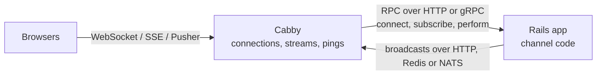
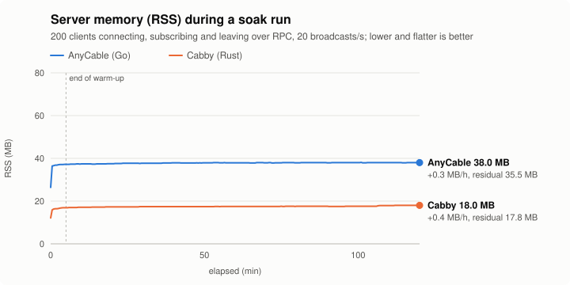

<p align="center">
  
</p>

# Cabby

Cabby is a real-time server for Rails apps (and other backends) that holds your WebSocket
connections so your app doesn't have to. It is an [AnyCable](https://github.com/anycable/anycable)-compatible
server written in Rust: the same client protocols, the same RPC contract with your app, and the
same CLI flags, environment variables and configuration file as the Go server it is ported from.

> **Status: feature-complete, reviewed, not yet production-proven.** Cabby passes its full
> compatibility suite (923 upstream test cases, including the conformance suite end to end, with
> SSE, Pusher, durable streams, Redis, NATS and mruby). An
> [independent review](docs/review/2026-11-fable-review.md) is done, and every finding it raised
> is fixed, with regression tests. It has not run in production yet: try it in staging first.

## Why Cabby

With Action Cable, every WebSocket lives inside your Puma processes, next to your web requests,
so connection count, memory and broadcast fan-out compete with the app itself. Cabby moves the
connections into a separate server. Your channels stay in Ruby and are called only when something
happens (connect, subscribe, perform), so idle connections cost your Rails app nothing.

Measured on one machine with the same workloads ([Benchmarks](#benchmarks)):

- **Much less memory per connection.** 9.7 KB per idle connection, against 30.7 KB for Action
  Cable and 26.6 KB for the Go server. With 10,000 idle clients: Cabby 109 MB, Action Cable
  390 MB, the Go server 288 MB.
- **Load Action Cable can't carry.** Action Cable runs on one Ruby core and topped out at 21–27k
  deliveries/s, falling tens of seconds behind and losing messages. Cabby delivered every message
  at 150k/s on 2 cores.
- **Lower tail latency than the Go server** (p99 22–36% lower at every load) at about the same
  CPU.
- **Nothing to rewrite.** Your channels, your broadcasts, the `anycable-rails` gem and the
  JavaScript client (`@rails/actioncable` or `@anycable/web`) stay as they are.

Not on Rails? Cabby also speaks the Pusher protocol, so pusher-js and Laravel Echo clients can
connect to it, and its RPC and broadcast interfaces are plain HTTP, so any backend can drive it.
With JWT identification and signed streams it can run with no RPC backend at all.

## How it fits



Cabby holds the connections and subscriptions, keeps stream history and sends pings. When a
client connects, subscribes or performs an action, Cabby calls your app over RPC and your channel
code decides. When your app broadcasts, it sends the message to Cabby, which delivers it to every
subscriber. Several Cabby nodes can share broadcasts through Redis or NATS.

## Features

- Action Cable protocol (`actioncable-v1-json`) and its extended version with stream history
- RPC to your app over HTTP or gRPC
- Broadcasting via HTTP, Redis (pub/sub or streams) and NATS; multi-node pub/sub via Redis or NATS
- Reliable streams: history and session recovery after a reconnect
- Presence
- JWT identification, signed streams and Turbo Streams
- Server-Sent Events
- Pusher protocol compatibility, including the Pusher REST API for broadcasts
- Durable Streams: HTTP catch-up, long polling and SSE
- Embedded NATS (`--embed_nats`), run as a supervised `nats-server` child process. Cabby looks for
  `CABBY_NATS_SERVER`, then `nats-server` next to the `cabby` binary, then on `PATH`; until there
  are release builds, install `nats-server` yourself ([`docs/enats.md`](docs/enats.md))
- mruby scripting for custom metrics output (cargo feature `mruby`, [`docs/mruby.md`](docs/mruby.md))
- Prometheus metrics and log lines named as in the Go server, so existing dashboards and alerts
  keep working

### Fixes over the reference server

- **Redis silently drops a subscription** ([AnyCable issue 275](https://github.com/anycable/anycable/issues/275)):
  the Go server stops delivering broadcasts until it is restarted. Cabby resubscribes within about
  1 s, or notices a half-open connection within about 10 s through a heartbeat.

## Install

Prebuilt binaries and a Docker image aren't available yet, so build from source. You need:

- Rust 1.100 or newer, via [rustup](https://rustup.rs) (`rustup update stable`). Development uses
  the version pinned in [`rust-toolchain.toml`](rust-toolchain.toml).
- `protoc`, the Protocol Buffers compiler, for the gRPC bindings (`brew install protobuf` or
  `apt install protobuf-compiler`).
- A C compiler (Xcode Command Line Tools on macOS, `build-essential` on Debian and Ubuntu). The
  TLS library compiles some C, and so does the bundled mruby.

```sh
cargo install --locked --git https://github.com/DaniG2k/cabby cabby-server
```

This puts the `cabby` binary in `~/.cargo/bin`. To leave out mruby scripting (and its C build),
add `--no-default-features`.

## Quick start

### Try it on its own

```sh
cabby --norpc --public --broadcast_adapter=http
```

`--public` accepts every connection and stream subscription without authentication, so use it
only locally. `--broadcast_adapter=http` takes broadcasts over HTTP, so no Redis is needed.
Clients connect to `ws://localhost:8080/cable`; broadcast to a stream with:

```sh
curl -X POST localhost:8090/_broadcast -H 'Content-Type: application/json' \
  -d '{"stream":"demo","data":"{\"text\":\"hello\"}"}'
```

[`docs/manual-testing.md`](docs/manual-testing.md) walks through connecting a WebSocket client,
SSE and metrics step by step.

### Next to a Rails app

Add the `anycable-rails` gem and run its generator (`bin/rails g anycable:setup`). Configure HTTP
RPC mounted at `/_anycable` and HTTP broadcasting, with the same secret in the app and in Cabby,
then start Cabby:

```sh
cabby --rpc_host=http://localhost:3000/_anycable --secret=…
```

Cabby prints the URLs it listens on at startup: point the gem's `http_broadcast_url` at the
broadcast one, and your JavaScript client at `ws://localhost:8080/cable`. To use gRPC RPC instead,
run the gem's RPC server (`bundle exec anycable`) and leave out `--rpc_host` (it defaults to
`localhost:50051`).

Every flag has an `ANYCABLE_*` environment variable, and `--config-path` reads a TOML file.
`cabby --help` lists them all.

## Benchmarks

The servers were driven by Cabby's external load harness ([`crates/cabby-bench`](crates/cabby-bench))
on one machine (AMD Ryzen 5 PRO 6650H, Linux 7.3). The server under test was pinned to 2 physical
cores (4 CPUs) and the load generator to the other 4 cores. Each workload got a warm-up run, then
5 rounds with the servers in a shuffled order; values are medians. Every delivered message was
reconciled by ID. "Go server" is the reference server Cabby is ported from (the `anycable-go`
binary, "(Go)" in the charts).

### Action Cable, the Go server and Cabby

- **Go server and Cabby**: release builds launched with identical flags (`--norpc --noauth
  --public_streams`, in-memory broker, HTTP broadcasts, about 20-byte payloads over loopback; the
  churn workload adds a 5 ms HTTP RPC).
- **Action Cable**: Rails 8.1 (`actioncable` + `railties`) on Puma 8.1 in one process, production
  mode, async adapter, Ruby 4.0 with YJIT, default worker pool; a `$pubsub` channel and a broadcast
  endpoint calling `ActionCable.server.broadcast` ([`bench/actioncable`](bench/actioncable)). In the
  churn workload it sleeps the same 5 ms in `connect`, `subscribed` and `disconnect` where the
  other two make RPC calls.

<p align="center">
  
  
  
  
</p>

| Workload | Metric | Action Cable (Ruby) | Go server | Cabby (Rust) |
|---|---|---:|---:|---:|
| Idle connections | Memory with 1,000 / 10,000 clients | 120 / 390 MB | 54 / 288 MB | **24 / 109 MB** |
| | Memory per extra connection | 30.7 KB | 26.6 KB | **9.7 KB** |
| Fan-out, 1,000 clients × 5 of 100 streams, 50k msg/s | Delivered | 53% of the rate, 17.6 s p99 behind | 100% | 100% |
| | Latency p50 / p99 | 12.8 s / 17.6 s | 0.39 / 0.86 ms | 0.31 / 0.67 ms |
| | Server CPU / memory | 1.00 core (saturated) / 454 MB | 1.20 cores / 72 MB | 1.06 cores / 30 MB |
| Same, 100k msg/s | Delivered | 26% of the rate; 2.0 M messages lost | 100% | 100% |
| | Latency p50 / p99 | 30.8 s / 45.5 s | 0.34 / 2.77 ms | 0.28 / 1.78 ms |
| | Server CPU / memory | 1.00 core / 1,030 MB | 2.10 cores / 72 MB | 1.92 cores / 30 MB |
| Same, 150k msg/s | Delivered | 16% of the rate; 7.4 M messages lost | 100% | 100% |
| | Latency p50 / p99 | 33.9 s / 47.7 s | 0.86 / 11.93 ms | 0.70 / 7.69 ms |
| | Server CPU / memory | 1.00 core / 1,550 MB | 2.95 cores / 72 MB | 2.79 cores / 30 MB |
| Large room: 5,000 clients on one stream, 100k msg/s | Delivered | 21% of the rate; 3.8 M lost | 100% | 100% |
| | Latency p50 / p99 | 30.8 s / 47.7 s | 27.3 / 65.8 ms | 24.8 / 51.6 ms |
| | Server CPU / memory | 1.00 core / 1,129 MB | 3.27 cores / 179 MB | 3.24 cores / 63 MB |
| Reconnect floods: 2,000 clients, 500 then 1,000 dropped at once, 5 ms app latency | Recovery after each wave | 2.8 s / 5.6 s | 0.81 s / 1.02 s | 0.81 s / 1.02 s |
| | Connect → welcome p99 | 2,143 ms | 97 ms | 93 ms |
| | Server memory | 177 MB | 101 MB | 58 MB |
| | Peak OS threads | 22 | 10 | 412 |
| Any workload | Missing / duplicate / out-of-order messages | up to millions / 0 / hundreds | 0 / 0 / 0 | 0 / 0 / 0 |

What this shows:

- **Action Cable can't keep up with any of these loads.** Ruby runs on one core (it was pegged at
  1.00), and Action Cable decodes and re-encodes each message for every subscriber. It topped out
  at 21–27k deliveries/s whatever was offered, fell tens of seconds behind, buffered up to 1.5 GB,
  lost millions of messages once its publisher queue filled, and delivered some out of order.
  Moving connections out of the Rails process fixes that, with either server.
- **Cabby uses a third of the Go server's memory** (9.7 KB vs 26.6 KB per connection; 30 MB vs
  72 MB under fan-out) and about a quarter of Action Cable's.
- **Cabby's tail latency is lower** (p99 22–36% below the Go server's at every load), with 1–12%
  less CPU at the same delivered rate; the CPU difference is close to run-to-run spread, so call
  it slightly better or equal.
- **Reconnect recovery is the same in Cabby and the Go server**: it is governed by the clients'
  backoff and the disconnect-queue rate, which both implement the same way.
- **The Go server uses far fewer OS threads.** Go runs its goroutines on about one thread per
  core. Cabby has a fixed set of helper threads, and a session waiting on an RPC call holds a
  parked thread (so that one slow RPC never delays other sessions): 412 during the reconnect
  flood. They are capped at 8,192 and exit 30 s after the backlog clears. Thread count never grows
  with idle connections.
- **Neither the Go server nor Cabby hit its throughput ceiling** at 150k deliveries/s on 2 cores,
  so peak throughput isn't compared. Not measured yet: slow readers, an unavailable RPC and
  multi-node (Redis/NATS) broadcast.

Reproduce: `cargo build --release -p cabby-server -p cabby-bench && cargo xtask reference-build &&
compat/scripts/bench-compare.sh` (Action Cable needs its gems: see
[`bench/actioncable`](bench/actioncable)), then `compat/scripts/bench-summary.py` and
`compat/scripts/bench-charts.py`. Raw results: [`docs/benchmarks/results`](docs/benchmarks/results)
(the Go server and Cabby re-measured together on the final build; Action Cable from the same
day's three-way run). Methodology: [`SPEC.md` §10](SPEC.md#10-performance-evaluation).

### Pusher-protocol servers

Cabby and the Go server also speak the Pusher protocol, so pusher-js and Laravel Echo clients can
use them in place of Pusher. They are compared here with the two common self-hosted Pusher
servers: **Soketi** 1.6.1 (Node.js 18 on uWebSockets) and **Laravel Reverb** 1.14 (PHP 8.4,
ReactPHP with the `ev` event loop). Hosted Pusher is not included (a paid service on unknown
hardware, and load-testing it would breach its terms).

The method is the same as above (same machine and pinning, warm-up, 5 shuffled rounds, medians,
every message reconciled by ID), with the harness speaking the pusher-js protocol 7 to
`/app/<key>` and broadcasting through the signed Pusher REST API, one event per request.
Production settings for every server; details in [`bench/pusher`](bench/pusher).

<p align="center">
  
  
  
</p>

| Workload | Metric | Soketi (Node.js) | Reverb (PHP) | Go server | Cabby (Rust) |
|---|---|---:|---:|---:|---:|
| Idle connections | Memory with 1,000 / 10,000 clients | 116 / 149 MB | 63 / 233 MB | 54 / 280 MB | **24 / 103 MB** |
| | Memory per extra connection | **3.7 KB** | 19.3 KB | 25.8 KB | 9.0 KB |
| Fan-out, 1,000 clients, 50k msg/s | Delivered / p99 latency | 100% / 24.8 ms | 90% of the rate / 84 ms | 100% / 0.90 ms | 100% / **0.74 ms** |
| Same, 100k msg/s | Delivered / p99 latency | 67% of the rate / 60 ms | 45% / 84 ms | 100% / 2.90 ms | 100% / **1.78 ms** |
| Same, 150k msg/s | Delivered / p99 latency | 44% / 60 ms | 30% / 88 ms | 100% / 15.2 ms | 100% / **8.9 ms** |
| | Server CPU / memory | 1.01 cores / 120 MB | 1.00 core / 64 MB | 3.08 cores / 69 MB | 2.86 cores / 29 MB |
| Large room: 5,000 clients, 100k msg/s | Delivered / p99 latency | 73% / 4.4 s | 87% / 2.8 s | 100% / 60 ms | 100% / **49 ms** |
| Reconnect floods: 2,000 clients, 500 then 1,000 dropped | Recovery / welcome p99 | 0.82 s / 113 ms | 0.82 s / 60 ms | 0.82 s / 1.0 ms | 0.82 s / **0.9 ms** |
| Any workload | Missing / duplicate / out-of-order | 0 / 0 / 0 | 0 / 0 / 0 | 0 / 0 / 0 | 0 / 0 / 0 |

What this shows:

- **Soketi and Reverb are single event loops**, so each tops out at about one core: Soketi at about
  66–73k deliveries/s, Reverb at about 45k (87k in the large room, where one broadcast reaches many
  clients). Beyond that they slow down the publishers (whose queues then drop publications) but
  lose nothing they accepted. The Go server and Cabby use all four cores and delivered everything.
- **Cabby has the lowest latency** at every load and the lowest total memory up to 10,000 clients.
- **Soketi has the smallest per-connection cost** (3.7 KB, thanks to uWebSockets) on top of a
  larger fixed baseline (about 113 MB for the Node runtime). Past roughly 18,000 connections Soketi
  would use less memory than Cabby; if you need very many mostly idle connections per process and
  little throughput, that's Soketi's strength.
- **Reconnect recovery is the same for all four**: it is governed by the clients' backoff.

Reproduce: `bench/soketi/setup.sh && bench/reverb/setup.sh` (the latter builds PHP into
`bench/reverb/.php`, about 10 minutes), then `compat/scripts/bench-compare-pusher.sh`,
`compat/scripts/bench-summary.py docs/benchmarks/pusher-results` and
`compat/scripts/bench-charts.py docs/benchmarks/pusher-results docs/benchmarks --protocol=pusher`.
Raw results: [`docs/benchmarks/pusher-results`](docs/benchmarks/pusher-results).

### Soak test: memory over hours of churn

Users of the Go server have reported memory that grows slowly over days in production
([AnyCable issue 265](https://github.com/anycable/anycable/issues/265)). To check both servers for
this, `cabby-bench soak` imitates a Rails app with Turbo pages for two hours: 200 clients keep
connecting (authenticated over RPC, 2% rejected), subscribing to 1–3 of 100 streams, navigating,
and leaving after 2–30 s (half with a close handshake, half by dropping the TCP connection), while
20 broadcasts per second go out. Both servers ran side by side on their own cores with the same
random schedule. After the run, the clients leave, the disconnect queue drains, and the leftover
memory is measured after 30 s.

<p align="center">
  
</p>

| | Go server | Cabby (Rust) |
|---|---:|---:|
| Sessions / subscriptions over 2 hours | 78,202 / 304,520 | 78,201 / 304,520 |
| Memory: idle → after warm-up → end | 26.4 → 37.2 → 38.0 MB | 12.1 → 16.9 → **18.0 MB** |
| Growth after warm-up (1st hour / 2nd hour) | 0.78 / 0.10 MB/h | 0.48 / 0.49 MB/h |
| After the clients left: memory / threads / sockets | 35.5 MB / 8 / 2 (baseline 2) | **17.8 MB** / 28 / 4 (baseline 4) |
| Delivery p99 latency | 0.94 ms | **0.81 ms** |
| Missing / duplicate / misrouted messages | 0 / 0 / 0 | 0 / 0 / 0 |

A slow creep of half a megabyte per hour could be a leak or the allocator settling, so both
servers were also run at nearly three times the churn: 400 clients living 1–3 s, about 211,000
sessions in 20 minutes. Neither server's memory grew with the number of sessions: Cabby levelled
off at 51.9–52.4 MB, the Go server at 139–140 MB, after about 10 minutes, so whatever leaks is
under a few bytes per session ([`docs/benchmarks/soak-churn`](docs/benchmarks/soak-churn)).

What this shows:

- **No leak on this workload, in either server.** Both level off, and sockets, file descriptors
  and threads go back to their idle counts once the clients leave. The upstream report may need
  something this workload doesn't do (a particular broker, days of uptime, or a Go runtime
  behavior).
- **Cabby uses half the memory** during the run and after it.
- **Freed memory is kept, not returned to the OS.** After the high-churn run, Cabby stayed at
  52 MB against 12 MB idle (glibc's allocator keeps freed pages for reuse); the Go server dropped
  from 140 to 69 MB (Go's runtime returns some). Peak memory is what to plan for with either
  server.

Reproduce: `cargo build --release -p cabby-server -p cabby-bench`, then
`DURATION=2h compat/scripts/soak-compare.sh` (the high-churn run: `DURATION=20m WARMUP=2m
CLIENTS=400 SOAK_ARGS="--lifetime-min=1s --lifetime-max=3s --pause-min=100ms --pause-max=500ms"`).
Raw results: [`docs/benchmarks/soak`](docs/benchmarks/soak).

## Compatibility

Cabby is a port of AnyCable's open-source Go server at the commit pinned in
[`compat/upstream.lock`](compat/upstream.lock) (`anycable/anycable@26a1a703`, server version
1.6.21). It was built tests-first: the whole upstream test corpus, 923 cases (Go unit tests,
Benchi, go-mruby, feature tests and the AnyT conformance suite), was translated to Rust and
verified against the Go server before any Cabby code was written. 914 cases are verified against
Go; 9 test behavior Go can't expose and run against Cabby only. All 923 pass against Cabby
([`compat/test-map.json`](compat/test-map.json), summarized by `cargo xtask report`).

Until Cabby has its own documentation, the [AnyCable server docs](https://docs.anycable.io) describe
its configuration and features. Intended differences from the Go server, such as Redis 6 or
later for pub/sub, are recorded in [`compat/deviations.md`](compat/deviations.md), most with a pinning test.
AnyCable Pro features are out of scope.

## Layout

```text
crates/cabby-core      protocol, JSON, hub, brokers, pub/sub, identity, configuration
crates/cabby-server    node, RPC, WebSocket/SSE/Pusher/durable streams, adapters, CLI, `cabby` binary
crates/cabby-mruby-sys vendored mruby 1.2.0 and its FFI boundary
crates/cabby-bench     external load harness (benchmarks and soak tests)
crates/cabby-testkit   backend selection, Go reference bridge, fake RPC, process supervision
tests/                 translated upstream tests (unit/<go package>, conformance, features)
tools/xtask            inventory, compatibility runner, reports
bench/                 other servers under test (Action Cable, Soketi, Reverb)
compat/                pinned reference, baseline evidence, manifest, deviations, adapters
docs/                  contributor guides, benchmark results, reviews
```

## Development

Toolchains are pinned in `mise.toml` (Rust 1.100.0 and protoc). Redis and NATS run in Docker.
Tests that restart NATS need a `nats-server` binary: set `CABBY_NATS_SERVER_BIN`, or have Go on
`PATH` and the test kit builds the pinned version.

```sh
mise install
eval "$(compat/scripts/services.sh start)"   # Redis + NATS for integration tests
cargo xtask test --backend rust         # translated tests against Cabby
cargo xtask report --by-package
```

The Go reference server is built and tested in CI. To run it locally, add Go 1.27.3 to
`mise.toml` (see the comment there), then:

```sh
cargo xtask reference-checkout          # pinned upstream into compat/reference
cargo xtask reference-build             # Go reference binary + test bridge
cargo xtask test --backend go           # translated tests against Go: must pass
```

See [`docs/implementing.md`](docs/implementing.md) and
[`docs/translating-tests.md`](docs/translating-tests.md).

## License and attribution

Cabby is released under the [MIT License](LICENSE).

Cabby's implementation is a port of the AnyCable Go server (MIT, © Vladimir Dementyev), pinned at
the commit in [`compat/upstream.lock`](compat/upstream.lock), and its translated tests and scenarios
derive from AnyCable, AnyT (MIT, © palkan) and go-mruby (MIT, © Mitchell Hashimoto). Their notices
are in [`compat/licenses/`](compat/licenses/). Cabby is an independent implementation, not
affiliated with the AnyCable project or Evil Martians.

Cabby statically links a C dependency: mruby 1.2.0 (MIT, © mruby developers) with the mruby-env
gem (MIT, © Internet Initiative Japan Inc.), vendored in
[`crates/cabby-mruby-sys`](crates/cabby-mruby-sys) for the optional mruby scripting feature (cargo
feature `mruby`, on by default on Linux and macOS). Their notices are
`compat/licenses/mruby-MITL` and `compat/licenses/mruby-env-LICENSE`; the binding's API is modeled
on go-mruby (see [`docs/mruby.md`](docs/mruby.md)).

Embedded NATS runs the separate `nats-server` binary (Apache-2.0, © The NATS Authors), which
Cabby does not include. Release artifacts that bundle `nats-server` next to `cabby`, as
[`docs/enats.md`](docs/enats.md) suggests, must ship its Apache-2.0 license notice with it.
