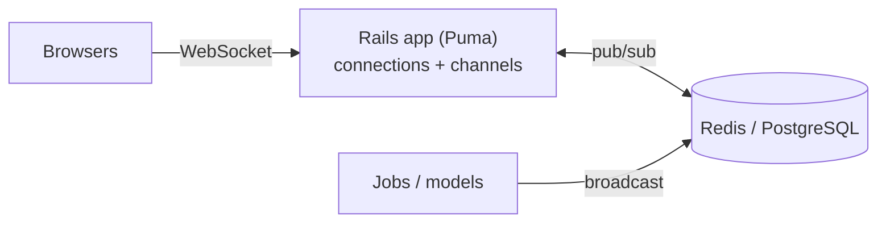
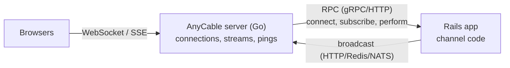
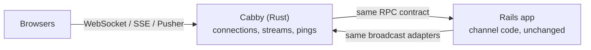
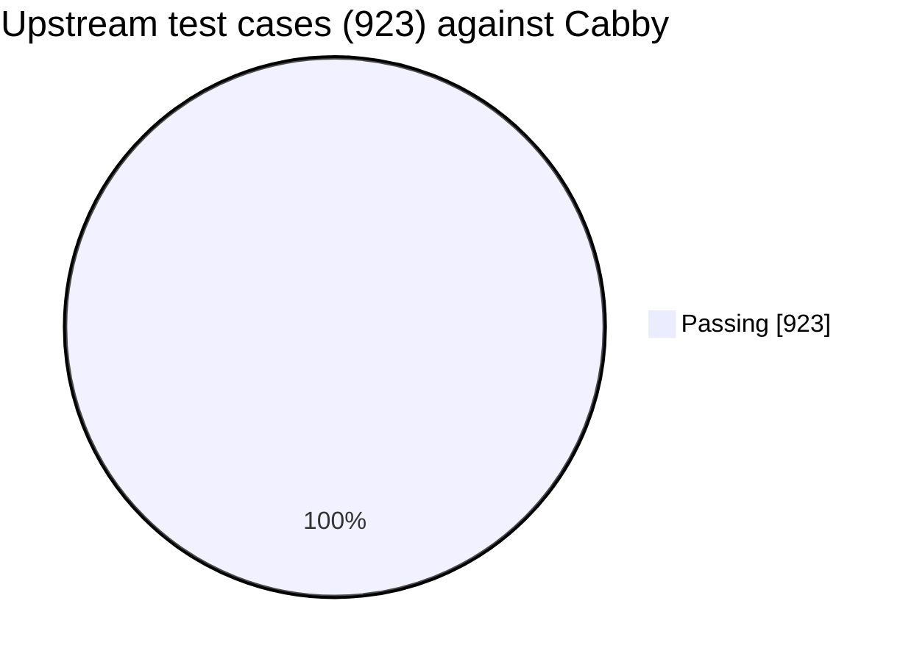

<p align="center">
  
</p>

# Cabby

An [AnyCable](https://github.com/anycable/anycable)-compatible real-time server written in
Rust. It is a drop-in replacement for the AnyCable server: the same Action Cable protocol, the
same RPC contract with your Rails app, the same CLI flags, environment variables and
configuration file. Cabby is an independent implementation; it is not affiliated with the
AnyCable project or Evil Martians.

> **Status: feature-complete.** `cabby` passes all 923 translated upstream test cases, including
> the full AnyT conformance suite end to end, with SSE, Pusher, durable streams, Redis, NATS and
> mruby (see [`SPEC.md`](SPEC.md)).

## Action Cable, AnyCable and Cabby

All three serve the same client: a browser using the `@rails/actioncable` (or AnyCable) JavaScript
client, talking to channels you write in Rails. They differ in **where the WebSocket connections
live** and what runs them.

### Action Cable: everything in the Rails process



Rails' built-in framework. Every WebSocket is held by a Ruby process alongside your web
requests, so connection count, memory and broadcast fan-out compete with the app itself.

### AnyCable: a dedicated WebSocket server, channels stay in Rails



The connections move to a standalone server. Your Rails channels are unchanged and are called
over RPC only when something happens (connect, subscribe, perform); idle connections cost the
Rails app nothing. AnyCable adds reliable streams (history and recovery), presence, JWT
identification, signed streams, SSE, Pusher compatibility and durable streams.

### Cabby: the same architecture, a Rust server



Cabby replaces the AnyCable server binary and nothing else: the Rails side (`anycable-rails`,
your channels, your broadcasts) and the JavaScript client stay as they are.

### Feature comparison

| | Action Cable | AnyCable (Go) | Cabby (Rust) |
|---|:---:|:---:|:---:|
| Where WebSockets are handled | Rails process | Go server | Rust server |
| Channel code | Ruby | Ruby (over RPC) | Ruby (over RPC, unchanged) |
| Action Cable protocol (`actioncable-v1-json`, extended protocol) | ✅ | ✅ | ✅ |
| RPC over gRPC and HTTP | n/a | ✅ | ✅ |
| Broadcasts via HTTP, Redis (pub/sub, streams), NATS | Redis/PostgreSQL | ✅ | ✅ |
| Multi-node pub/sub (Redis, NATS) | via adapter | ✅ | ✅ |
| Reliable streams: history and session recovery | – | ✅ | ✅ |
| Presence | – | ✅ | ✅ |
| JWT identification, signed and Turbo streams | – | ✅ | ✅ |
| Server-Sent Events | – | ✅ | ✅ |
| Pusher protocol compatibility | – | ✅ | ✅ |
| Durable Streams (HTTP catch-up, long-poll, SSE) | – | ✅ | ✅ |
| Embedded NATS | – | ✅ (in-process) | ✅ (bundled `nats-server` child process) |
| mruby metrics printers | – | ✅ | ✅ |
| Recovers when Redis silently drops a subscription ([AnyCable issue 275](https://github.com/anycable/anycable/issues/275)) | – | ❌ stays broken until restart | ✅ resubscribes (~1 s) / heartbeat (~10 s) |
| Concurrency model | Ruby threads | goroutines | Tokio tasks; no OS thread per connection |

AnyCable features above are those of the pinned open-source server
(`anycable/anycable@26a1a703`); AnyCable Pro features are out of scope. Intended differences from
the Go server are recorded in [`compat/deviations.md`](compat/deviations.md), most with a pinning test.

## Benchmarks: Go vs Rust

| Workload | AnyCable (Go) | Cabby (Rust) |
|---|---|---|
| Idle connections: memory per connection | pending | pending |
| Broadcast fan-out: delivered msg/s, p50/p95/p99 latency | pending | pending |
| Connection churn and resubscription | pending | pending |
| Slow readers mixed with healthy clients | pending | pending |
| Slow or unavailable RPC with queue saturation | pending | pending |
| Cluster broadcast and reconnect recovery | pending | pending |

No numbers yet: results (with charts) will be published once Cabby passes the full
compatibility suite, using the external load harness in [`crates/cabby-bench`](crates/cabby-bench)
against both binaries on the same hardware and settings, with the load generator outside the
measured process and repeated runs. Workloads where Rust is not faster will be reported too.
Methodology: [`SPEC.md` §10](SPEC.md#10-performance-evaluation).

One early, non-benchmark observation from the conformance suite (`tests/conformance/threads.rs`):

| Server OS threads | AnyCable (Go) | Cabby (Rust) |
|---|---:|---:|
| Change after opening 300 more idle connections | +4 | +0 |
| Change during 20 broadcasts to 301 subscribers | +0 | +0 |

## Compatibility progress

Cabby is built tests-first: AnyCable's entire test corpus was translated to Rust and verified
against the Go server before any Cabby code was written; a feature counts as done when its
translated tests pass against Cabby.



| | Count |
|---|---:|
| Upstream cases (Go unit tests, Benchi, go-mruby, features, AnyT conformance) | 923 |
| Translated to Rust and independently reviewed | 923 |
| Verified against the Go server | 914 |
| Go cannot expose the behavior (`not_observable`, tested against Rust only) | 9 |
| **Passing against Cabby** | **923** |

Source of truth: [`compat/test-map.json`](compat/test-map.json), summarized by `cargo xtask report`.

## Layout

```text
crates/cabby-core      protocol, JSON, hub, brokers, pub/sub, identity, configuration
crates/cabby-server    node, RPC, WebSocket/SSE/Pusher/durable streams, adapters, CLI, `cabby` binary
crates/cabby-bench     external load harness (Go vs Rust comparisons)
crates/cabby-testkit   backend selection, Go reference bridge, fake RPC, process supervision
tests/                 translated upstream tests (unit/<go package>, conformance, features)
tools/xtask            inventory, compatibility runner, reports
compat/                pinned reference, baseline evidence, manifest, deviations, adapters
docs/                  contributor guides
```

## Development

Toolchains are pinned in `mise.toml` (Rust 1.100.0, plus Go 1.27.3 and protoc for the reference
server during the port).

```sh
mise install
cargo xtask reference-checkout          # pinned upstream into compat/reference
cargo xtask reference-build             # Go reference binary + test bridge
eval "$(compat/scripts/services.sh start)"   # Redis + NATS for integration tests
cargo xtask test --backend go           # translated tests against Go: must pass
cargo xtask test --backend rust         # against Cabby: pass or explicitly pending
cargo xtask report --by-package
```

See [`docs/implementing.md`](docs/implementing.md) and
[`docs/translating-tests.md`](docs/translating-tests.md).

## License and attribution

Cabby is released under the [MIT License](LICENSE), the same license as AnyCable.

Translated tests and scenarios derive from AnyCable (MIT, © Vladimir Dementyev), AnyT
(MIT, © palkan) and go-mruby (MIT, © Mitchell Hashimoto). Their notices are in
[`compat/licenses/`](compat/licenses/).

Cabby statically links a C dependency: mruby 1.2.0 (MIT, © mruby developers) with the
mruby-env gem (MIT, © Internet Initiative Japan Inc.), vendored in
[`crates/cabby-mruby-sys`](crates/cabby-mruby-sys) for the optional mruby scripting
feature (cargo feature `mruby`, on by default on Linux and macOS). Their notices are
`compat/licenses/mruby-MITL` and `compat/licenses/mruby-env-LICENSE`; the binding's API
is modeled on go-mruby (see [`docs/mruby.md`](docs/mruby.md)).
