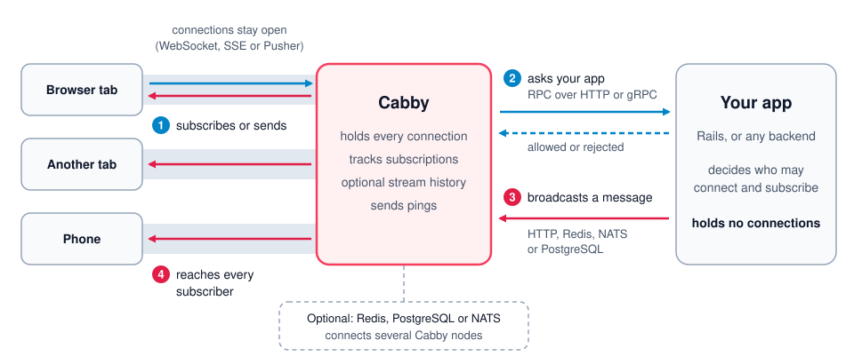

<p align="center">
  
</p>

# Cabby

Cabby is a real-time server for Rails apps (and other backends) that holds your WebSocket
connections so your app doesn't have to. It is an [AnyCable](https://github.com/anycable/anycable)-compatible
server written in Rust: the same client protocols, the same RPC contract with your app, the same
flags and `anycable.toml`. Swap the binary, keep your channels. It also speaks the Pusher protocol
(pusher-js, Laravel Echo).

**[Website](https://cabbyhq.com)** · **[Documentation](https://docs.cabbyhq.com/install)** · [Releases](https://github.com/DaniG2k/cabby-releases/releases) · [Changelog](CHANGELOG.md)

## Benchmarks

Medians of 5 runs on one machine, the same settings and workloads for every server.

**At least 4× the load on one core,** with p99 kept under 50 ms, at untuned settings.

<p align="center">
  
</p>

**About a third of AnyCable's memory,** and it stays low with large messages.

<p align="center">
  
</p>

**Lower latency from 50k to 150k messages/s.**

<p align="center">
  
</p>

Cabby doesn't win everywhere: it uses more OS threads (102 against AnyCable's 10 with 10,000 idle
clients, 411 against 10 in a reconnect flood), reconnects take as long as AnyCable's, and Soketi
needs less CPU at 50k msg/s.
[`docs/benchmarks.md`](docs/benchmarks.md) has every workload, the Soketi and Reverb comparison, the
method, and the scripts to rerun it all.

## How it fits

<p align="center">
  
</p>

Your app runs only when something happens, so idle connections cost it nothing. With JWT and signed
streams, Cabby can skip step 2.

## Quick start

```sh
docker run --rm -p 127.0.0.1:8080:8080 -p 127.0.0.1:8090:8090 ghcr.io/danig2k/cabby:0.5.4 --norpc --public

curl -X POST localhost:8090/_broadcast -H 'Content-Type: application/json' \
  -d '{"stream":"demo","data":"{\"text\":\"hello\"}"}'
```

Clients connect to `ws://localhost:8080/cable`. `--public` skips authentication, so use it only
locally. For a Rails app, add `anycable-rails`, run `bin/rails g anycable:setup` and start
`cabby --rpc_host=http://localhost:3000/_anycable --secret=…`.

Prebuilt binaries for Linux and macOS are on the
[releases page](https://github.com/DaniG2k/cabby-releases/releases); there are guides for
[Kamal](docs/deploy-kamal.md), [Rails, Hotwire, Laravel, Node.js and Django](https://docs.cabbyhq.com/rails),
and [building from source](docs/development.md#build-from-source).

## What it does

- **Protocols:** Action Cable, Pusher, Server-Sent Events, Durable Streams
- **Your app:** RPC over HTTP or gRPC; broadcasts over HTTP, Redis, NATS or PostgreSQL
- **History and session recovery:** in memory, SQLite, [Redis](docs/redis-broker.md),
  [PostgreSQL](docs/postgres.md) or NATS
- **Several nodes:** Redis, PostgreSQL or NATS pub/sub
- **Security and operations:** JWT, signed streams, presence, Prometheus metrics

Configuration: [`docs/configuration.md`](docs/configuration.md). Compatibility and migrating from
AnyCable: [`docs/compatibility.md`](docs/compatibility.md). Building and testing:
[`docs/development.md`](docs/development.md). Third-party licenses:
[`docs/third-party.md`](docs/third-party.md).

## Support

Cabby is free. If it saves you servers or memory, you can
[buy me a coffee](https://buymeacoffee.com/cabbyhq).

## License and attribution

Cabby is released under the [MIT License](LICENSE).

Cabby's implementation is a port of the AnyCable Go server (MIT, © Vladimir Dementyev), pinned at
the commit in [`compat/upstream.lock`](compat/upstream.lock), and its translated tests and scenarios
derive from AnyCable, AnyT (MIT, © palkan) and go-mruby (MIT, © Mitchell Hashimoto). Their notices
are in [`compat/licenses/`](compat/licenses/). Cabby is an independent implementation, not
affiliated with the AnyCable project or Evil Martians.
