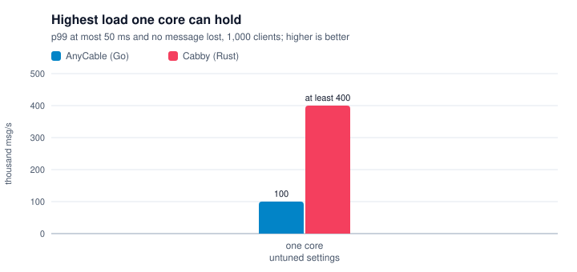
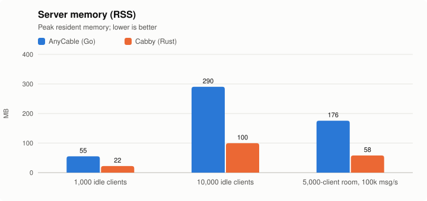
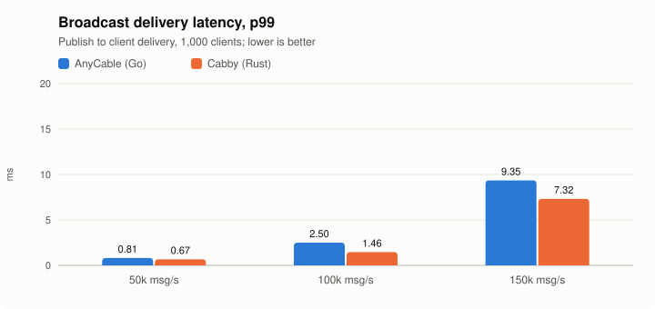
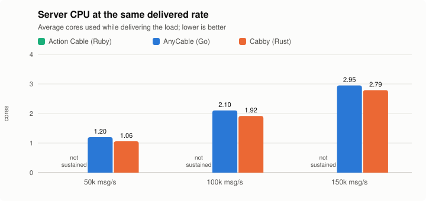
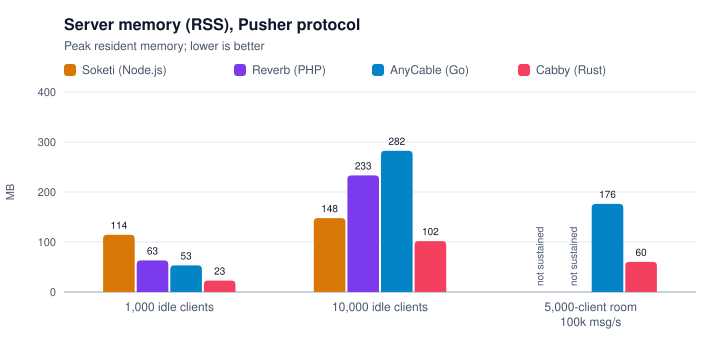
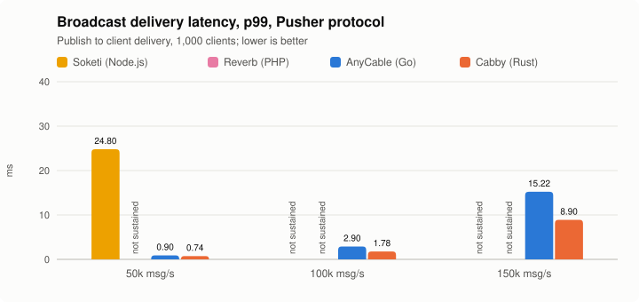

# Benchmarks

Every number is the median of 5 runs, in a shuffled server order after a warm-up, on one machine
(AMD Ryzen 5 PRO 6650H, Linux 7.3). The server is pinned to 2 physical cores (4 CPUs), or to 1 for
the ceiling; the load generator has 4 other cores. Every message is checked by ID, except in the
reconnect test, which measures recovery: Cabby lost, duplicated or reordered none in 115 checked
runs. A run the generator limited is excluded; none was. Raw results are in [`benchmarks/`](benchmarks). Cabby
is commit `a79dc2b` (0.4.0), and the Go server is AnyCable 1.6.21 at default settings.

## One-core ceiling

The highest rate a server holds with a p99 of at most 50 ms and no message lost
(1,000 clients, 20 streams, 5 subscriptions each). The server has one physical core (CPUs 0 and 1,
its two threads) and the generator 8 threads; `environment.txt` says 4, because the script writes
it before raising the number. AnyCable still delivered everything at 150k and 200k, with a higher p99.

| Offered | AnyCable | Cabby |
|---|---:|---:|
| 100k msg/s | 31.7 ms | **5.7 ms** |
| 150k | 270.8 ms | **9.4 ms** |
| 200k | 831.8 ms | **11.4 ms** |
| 400k (top of the ladder) | not sustained | **16.8 ms** |
| **Highest rate held** | 100k | **at least 400k** |

Above 200k AnyCable used less CPU than it could and lost messages, so its limit may be in its own
queueing and not in the core.

<p align="center">
  
</p>

## Action Cable, AnyCable and Cabby

Cabby and AnyCable run as release builds with the same flags and no broker (`--broker=none`, so no
stream history); Action Cable is Rails 8.1 on Puma. Messages are about 20 bytes except where noted.

| Workload | Metric | Action Cable | AnyCable | Cabby |
|---|---|---:|---:|---:|
| Idle, 1,000 / 10,000 clients | Memory | 119 / 403 MB | 55 / 292 MB | **23 / 108 MB** |
| | Memory per extra connection | 32.3 KB | 26.9 KB | **9.6 KB** |
| Fan-out 50k msg/s | p99 / CPU | not sustained | 0.86 ms / 1.23 | **0.70 ms / 1.05** |
| 100k | p99 / CPU | not sustained | 2.63 ms / 2.09 | **1.33 ms / 1.74** |
| 150k | p99 / CPU | not sustained | 10.30 ms / 2.99 | **6.64 ms / 2.61** |
| 5,000-client room, 100k msg/s | p99 / memory | not sustained | 54 ms / 180 MB | **47 ms / 62 MB** |
| Reconnects: 2,000 clients, 500 then 1,000 dropped | Recovery, welcome p99 | 2.8 s / 5.7 s, 2.3 s | 0.8 / 1.0 s, 97 ms | 0.8 / 1.0 s, 93 ms |
| | Memory / threads | 179 MB / 22 | 101 MB / **10** | **57 MB** / 411 |
| Idle, 10,000 clients | OS threads | 27 | **10** | 102 |

"Not sustained": Action Cable was limited to one Ruby core and fell behind, dropped or lost
messages. The CPU is average cores used.

### Message size

1,000 clients, 5 streams each, except the room (5,000 clients in one stream).

| | AnyCable CPU / p99 / memory | Cabby CPU / p99 / memory |
|---|---:|---:|
| 1 KiB, 40k msg/s | 1.67 / 0.94 ms / 72 MB | **0.89 / 0.67 ms / 29 MB** |
| 8 KiB, 10k msg/s | 0.61 / 1.54 ms / 73 MB | **0.43 / 1.33 ms / 30 MB** |
| Room, 32 KiB | 0.44 / 88 ms / 179 MB | **0.36 / 66 ms / 62 MB** |

Action Cable used 694 MB in the 32 KiB room. Cabby 0.3.0 used about 318 MB (an earlier 3-round run).

<p align="center">
  
  
  
</p>

## Pusher-protocol servers

The same method over the Pusher protocol, with each server in its production settings
([`bench/pusher`](../bench/pusher)): Soketi 1.6.1 (Node.js), Reverb 1.14 (PHP), AnyCable and Cabby.

| Workload | Metric | Soketi | Reverb | AnyCable | Cabby |
|---|---|---:|---:|---:|---:|
| Idle, 1,000 / 10,000 clients | Memory | 114 / 148 MB | 63 / 233 MB | 53 / 282 MB | **23 / 102 MB** |
| | Memory per extra connection | **3.8 KB** | 19.3 KB | 26.1 KB | 9.0 KB |
| | OS threads, 10,000 clients | 11 | **1** | 10 | 102 |
| Fan-out 50k msg/s | p99 | 11.4 ms | not sustained | 0.94 ms | **0.70 ms** |
| 100k | p99 | not sustained | not sustained | 2.90 ms | **1.69 ms** |
| 150k | p99 | not sustained | not sustained | 13.81 ms | **8.48 ms** |
| 5,000-client room, 100k msg/s | p99 / memory | not sustained | not sustained | 52 ms / 176 MB | **47 ms / 60 MB** |
| Reconnects | Recovery, welcome p99 | 0.8 s, 107 ms | 0.8 s, 107 ms | 0.8 s, 1.2 ms | 0.8 s, 0.9 ms |

Soketi and Reverb run one event loop: fan-out topped out at about 70k and 46k deliveries/s, the room
at 75k and 92k.

<p align="center">
  
  
</p>

## Two-hour soak

200 clients connect, subscribe, leave and come back for two hours while 20 broadcasts per second go
out (measured 2026-11-20, before 0.4.0).

| | AnyCable | Cabby |
|---|---:|---:|
| Memory: idle, after warm-up, end | 26 / 37 / 38 MB | 12 / 17 / **18 MB** |
| Growth per hour, 1st / 2nd hour | 0.78 / 0.10 MB | 0.48 / 0.49 MB |
| Delivery p99 | 0.94 ms | **0.81 ms** |
| Missing, duplicate or misrouted | 0 | 0 |

A run at three times the churn (211,000 sessions in 20 minutes) levelled off in both servers. Both
return to their idle sockets and threads; memory freed stays with the process (52 MB for Cabby, 69
for AnyCable). Raw results: [`soak`](benchmarks/soak) and [`soak-churn`](benchmarks/soak-churn).

## Where Cabby ties or loses

- **OS threads:** more than every other server in every test (102 against 10 for AnyCable with
  10,000 idle clients). A session that waits on an RPC call holds its own thread, so that a slow
  call can't delay the others: 411 against 10 in the reconnect flood.
- **CPU:** Soketi used less at 50k msg/s over the Pusher protocol (0.78 cores against 1.03). With
  1,000 idle clients Cabby used 0.08 cores, AnyCable 0.07 and Action Cable 0.03.
- **Reconnects:** recovery as fast as AnyCable's. Over the Pusher protocol, some of Cabby's
  confirmation and worst-case times are up to about 1 ms longer.
- **Idle latency over Pusher:** a tie with 10,000 clients (p99 3.35 ms, AnyCable 3.33 ms).
- **Memory per extra Pusher connection:** 3.8 KB for Soketi, 9.0 KB for Cabby, so Soketi would use
  less in total at some point above 10,000 clients.

Not measured: slow readers, an unavailable RPC, several nodes, TLS, and a real network. On loopback
the kernel does the receiving side of every write too, which is most of the cost.

## Reproduce

```sh
cargo build --release -p cabby-server -p cabby-bench && cargo xtask reference-build
compat/scripts/bench-compare.sh                                          # the first table and the sizes
SERVER_CPUS=0-1 SUTS="anycable-go cabby" WORKLOADS=ceiling compat/scripts/bench-compare.sh OUT
bench/soketi/setup.sh && bench/reverb/setup.sh && compat/scripts/bench-compare-pusher.sh
DURATION=2h compat/scripts/soak-compare.sh
compat/scripts/bench-summary.py RESULTS && compat/scripts/bench-charts.py RESULTS docs/benchmarks
```

Action Cable needs its gems ([`bench/actioncable`](../bench/actioncable)). The method is in
[`SPEC.md` section 10](../SPEC.md#10-performance-evaluation).
